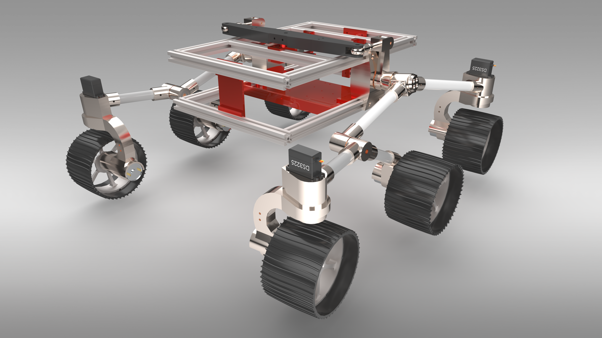
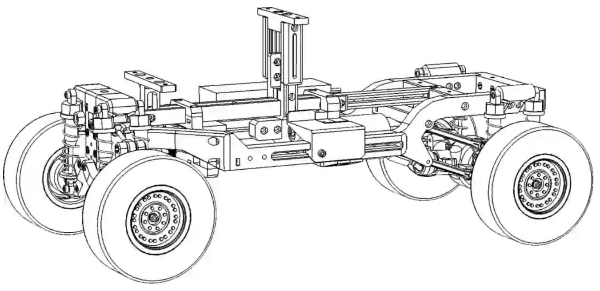

# RoboPack mechanical design

The files include the current 6-Wheel Bogey Suspension and the original RC Car.

The controller uses the dimensions of the current suspension like wheelbase, maximum road-wheel angle
and loaded footprint about the rear axle for config/robot.conf. So, if using a different setup, **adapt the controller**.

I have provided the full STL files for both the current 6-Wheel Bogey Suspension and the original RC
Car assemblies.

Please note that I am not distributing the original CAD source files (such as STEP, or native
parametric files), as this project is currently transitioning into a commercial venture.

## Current Bogey Suspension Assembly

## Older RC Car Assembly

